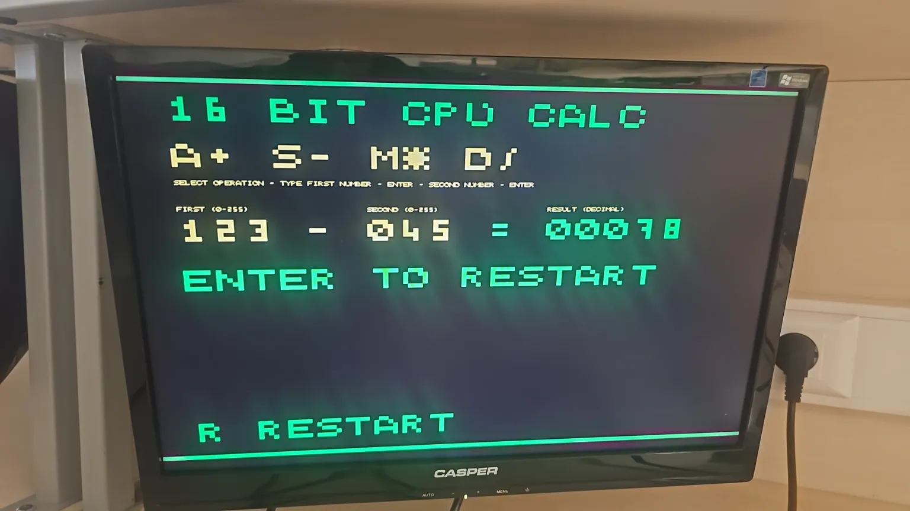

# 16-bit Pipelined CPU on FPGA

A personal CPU project implemented in VHDL on the **Digilent Basys 3**, with a
PS/2 keyboard and VGA text display.

*Monitor output from the calculator software running on the Basys 3 CPU.*

## Features

- Five-stage IF / ID / EX / MEM / WB pipeline.
- Forwarding, automatic LOAD-use stalls and branch flushing.
- Custom 16-bit ISA, 12 general-purpose registers and four readable flag registers.
- Register-based absolute jumps and software-managed function calls.
- Separate 32K-word program ROM and 56K-word main RAM, using 16-bit word addresses.
- Memory-mapped keyboard FIFO with 31 usable entries.
- 640x480 VGA output, eight colors and a 128x96 grid of 5x5 character cells.
- Writable glyph RAM for 256 custom symbols.

**Board/tool:** Basys 3 (`xc7a35tcpg236-1`), Vivado 2025.2, VHDL-2008,
100 MHz system clock.

## Demonstrations and testing

I have run the keyboard/VGA demo, calculator and AES encryptor/decryptor on the
FPGA. The calculator and AES execute as software using the existing ISA;
there is no dedicated AES, multiplication or division accelerator.

| Program | ROM initialization file |
|---|---|
| Keyboard/VGA | `firmware/keyboard/vga_keyboard_demo_margin.coe` |
| Calculator | `firmware/presentation/presentation_calculator.coe` |
| AES-128 | `firmware/aes/aes128_keyboard_vga.coe` |
| Animation | `firmware/presentation/presentation_animation.coe` |

I reran the supplied VHDL tests locally on Windows with GHDL 6.0.0 (mcode)
on 26 November 2026: **all five CPU programs, AES, calculator, animation, and
the standalone VGA regression passed**. The tests and utilities were written
by ChatGPT/Codex; these runs were executed on my computer. The VGA regression
completed 10,089,816 checks. [Local run logs](tests/local_runs/2026-11-26/README.md)
are included. **Fibonacci and the animation are simulation-tested; I have not
run them on the FPGA.**
See [validation](docs/validation.md) for the test scope and logs.

## Implementation results

On 25 November 2026, I recorded these Vivado results from my existing
implemented Basys 3 project (100 MHz system clock):

| Resource | Used | Available | Utilization |
|---|---:|---:|---:|
| Slice LUTs | 762 | 20,800 | 3.66% |
| Slice registers | 516 | 41,600 | 1.24% |
| Block RAM tiles | 42 | 50 | 84.00% |

Setup WNS and hold WHS are both **+0.055 ns**, with zero failing endpoints.
Vivado reports that all user-specified timing constraints are met. These are
whole-system results, including memories and peripherals, rather than CPU-only
figures. The timing margin is small; these reports do not verify a clean rebuild
from this repository. See [validation](docs/validation.md) for scope and details.

## Build

The previous project-creation script was removed after a clean rebuild attempt
failed while opening the imported block design. A verified project-recreation
procedure is not yet available. The existing hardware demonstrations above
were run using my working Vivado project.

The keyboard uses an external PS/2 connection on JA: clock J1, data L2.
The hardware setup includes a logic level shifter between the PS/2 keyboard
and the Basys 3.
See [build notes](docs/build.md) for memory configuration and the current build status.

## Contributions and AI assistance

I designed the CPU architecture, instruction set and pipeline, integrated the
system, and tested it on hardware. ChatGPT/Codex assisted with CPU review
and debugging.

**ChatGPT/Codex wrote the VGA module, all Tcl scripts, the demo/test programs
(including calculator and AES), and the accompanying build/test utilities.**
The documentation was also prepared with AI assistance. These components were
integrated and tested on the board as described above.

The font is from [nitram-micro-font](https://github.com/nitram509/nitram-micro-font)
by Martin W. Kirst; its MIT license is included. See [NOTICE.md](NOTICE.md).

## Source layout

`rtl/` contains CPU, keyboard/FIFO and VGA modules; `vivado/` and `constraints/`
contain the block design and pin assignments. `firmware/` holds the demos/font,
and `tests/` holds regression programs and testbenches.
The [ISA](docs/isa.md) and [display/keyboard map](docs/display-and-keyboard.md)
are documented separately.
